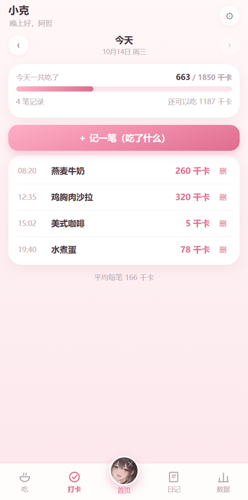
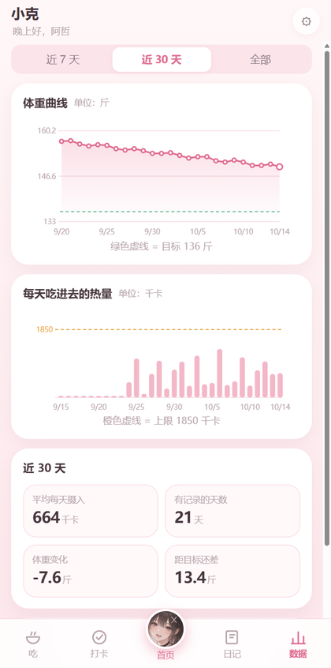
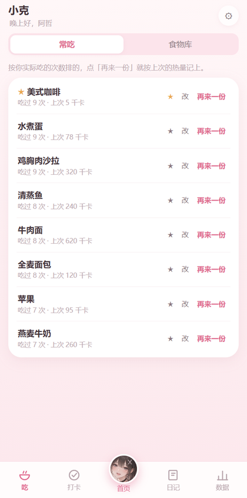
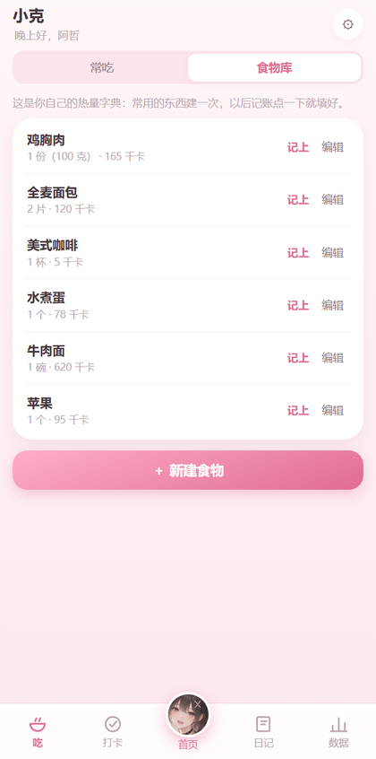

<div align="center">

# SlimPal

**完全离线的减肥陪伴 App**

记录饮食、称体重、写日记 —— 一位叫「小克 / Chloe」的虚拟女孩看着你的真实数据，
换姿势、说对应的话、督促你坚持下去。

不登录 · 不联网 · 无云服务 · 数据只存在你自己的设备上

Windows 桌面 · 安卓 · 浏览器，**同一套代码**





</div>

---

## 这是什么

市面上的减肥 App 要么逼你每天完成一堆打卡任务，要么把数据传到云端。SlimPal 反着做：

- **记录必须足够轻**：吃一餐就加一条，填「吃了什么 + 多少热量」，不设早餐午餐晚餐，也没有"漏打卡"
- **反馈必须有人味**：同一句"今天超了 300 千卡"，由她说出来和看一个红色数字，是完全不同的感受
- **数据必须是自己的**：没有任何网络请求，拔了网线照常用

开头她会问你身高体重和减重目标，按 Mifflin-St Jeor 公式算出基础代谢，再结合活动量与减重速度给出每日热量上限。之后每减掉目标的十分之一，她会专门为你庆祝一次。

## 界面

|  |  |
|---|---|
|  | **开场**：她居中淡入，一句一句介绍自己，每句换一个姿势。介绍完，注册表单从下方升上来把她顶上去 |
|  | **首页**：她本人 + 气泡，下面是今天还能吃多少、目标进度、今天还没做的事。**点她本人会有反应** |
|  | **打卡**：今天吃了什么。每记一笔，23 小时提醒倒计时就重置 |
|  | **吃**：常吃列表按你实际吃的次数自动排出来，点「再来一份」按上次的热量记上 |
|  | **食物库**：自己建的热量字典，建一次以后一键记账 |
|  | **日记**：写心情和文字，自动带上当天的体重和热量 |
|  | **数据**：体重曲线（绿虚线是目标）、热量柱状（橙虚线是上限）、阶段统计 |
|  | **里程碑**：每减掉目标的 1/10，她整屏居中淡入为你庆祝 |

## 技术要点

### 1. 前端零第三方依赖

`app/` 里没有任何框架、没有构建步骤、没有 npm 依赖。折线图、柱状图、进度环、路由、状态管理、组件系统全部手写 —— 图表是直接拼 SVG。

代价是要自己造轮子；好处是这个 App **不会因为某个依赖被删库而跑不起来**，也没有供应链风险。对一个"数据只存本机"的 App 来说，这个取舍是值得的。

### 2. 一套代码，三个平台

```
app/              纯 HTML/CSS/JS，所有平台共用这一份
 ├─ build/        Electron 壳 → Windows 安装包（托盘常驻、可关闭的开机自启）
 └─ android/      Capacitor 壳 → 安卓 APK
```

界面、数据层、角色系统完全共用；两个壳只负责平台能力（文件读写、系统通知、开机自启）。改一次界面，两端同时生效。

### 3. 数据一定不能丢

这是硬需求，所以做了三层：

| 层 | 做法 |
|---|---|
| 主存储 | 桌面端写入 `%APPDATA%\SlimPal\data.json`，**先写临时文件再改名**，避免写一半断电损坏 |
| 兜底 | 同时写 localStorage；数据文件损坏或缺失时自动退回 |
| 逃生舱 | 一键导出 JSON 备份 / 导入恢复，卸载重装也不怕 |

改名（减肥姬 → SlimPal）时还加了 `migrateUserData()`：userData 目录跟着 App 名变，第一次以新名字启动会把旧目录的数据复制过来。**这条逻辑是造了一份假数据实测过的**，不是写完就算。

### 4. 角色是可插拔的

一个角色 = 一个文件（`app/js/characters/*.js`），里面是形象素材路径 + 按场景分组的台词库 + 每个场景可用的立绘姿势。

```js
// 台词和姿势共用同一个随机序号，所以「换一句」的时候姿势也跟着换
{ scene: 'greetEvening', text: '晚上好，{name}。今天吃了 {kcal} 千卡',
  poses: ['portrait', 'alt'] }
```

想加第二位减肥姬，只要放素材、加一个角色文件、在 `index.html` 引一行 —— App 本体、数据层、页面都不用动。

### 5. 素材是自己从设定图里抠出来的

小克的立绘和 9 个表情，全部由 `tools/` 下的脚本从 3 张角色设定图产出：

- 用 `rembg` 的 `isnet-anime` 模型抠图（原图有白底也有深色渐变底）
- 设定图周围有装饰文字、爱心、相邻卡片的灰边 —— 用**只保留最大连通块**的办法滤掉
- 表情卡片底部有粉色标签角标会混进裁切结果 —— 按采样到的色值（冷粉，蓝略高于绿）程序化定位标签位置，把裁切底边卡在标签上方

产出 14 个素材，流程可复现：删掉 `app/assets/chloe/` 重跑一遍，13 个文件逐字节一致。

### 6. 测试要能真的发现问题

三套自检脚本，共 **101 项断言**：

| 脚本 | 项数 | 测什么 |
|---|---|---|
| `verify-ui.js` | 17 | 界面结构、文字、**像素级位置**、动画是否真的播了 |
| `verify-app.js` | 71 | 功能端到端：走一遍真实界面流程 |
| `verify-desktop.js` | 13 | 页面 → 主进程 → 磁盘文件 → 重开读回 |

几个值得一提的断言：

- 「开场小克水平居中」是**量出来的**：比较立绘中心与容器中心的偏差 ≤ 6px
- 「表单从下顶上来」是**读 `getComputedStyle().animationName`** 验证的，并且断言再翻一页时**不再重播**
- 「引导页全程不用 Q 版」会真的点完 11 屏，逐屏检查图片 `src`
- 「点击小克有互动」连点 8 次，断言拿到的回话**必须全部来自 `poke` 那一组台词**（否则就退化成换一句背景台词了）
- 有一条测试专门验证**测试工具本身可靠**：走引导的循环必须看到步号从 1 连续走到 8，卡住即失败 —— 这里踩过坑，原先循环固定跑 8 次，卡住也会"通过"

## 快速开始

不装任何东西，直接双击 `app/index.html` 就能在浏览器里用。

带桌面壳（托盘、系统通知、数据落盘）：

```powershell
cd build
npm install
npx electron .          # 开发运行
npx electron shot.js    # 逐页截图到 tools/shots/
```

自检（改完务必跑一遍）：

```powershell
cd build
npx electron verify-ui.js        # 17 项
npx electron verify-app.js       # 71 项
npx electron verify-desktop.js   # 13 项
```

打包：

```powershell
# Windows 安装包
cd build
npx electron-builder --win --x64

# 安卓 APK（需要 JDK 17 + Android SDK 34）
cd android
npx cap sync android
cd android && .\gradlew.bat assembleRelease
```

> 国内网络下打包若卡在下载，先设镜像：
> `$env:ELECTRON_MIRROR="https://npmmirror.com/mirrors/electron/"`
> `$env:ELECTRON_BUILDER_BINARIES_MIRROR="https://npmmirror.com/mirrors/electron-builder-binaries/"`

重新生成角色素材：

```powershell
python -m pip install rembg onnxruntime   # 首次会下载约 176 MB 的抠图模型
python tools/build_assets.py              # 生成 app/assets/chloe/ 全套
python tools/make_icons.py                # App 图标与托盘图标
python tools/make_android_res.py          # 安卓图标与启动图
```

## 项目结构

```
slimpal/
├─ app/                     应用本体：纯 HTML/CSS/JS，无构建步骤
│  ├─ index.html
│  ├─ css/app.css
│  ├─ js/
│  │  ├─ util.js  calc.js  store.js  ui.js  charts.js
│  │  ├─ chloe-view.js  actions.js  notify.js  onboarding.js  app.js
│  │  ├─ characters/chloe.js     角色包（加新角色只动这里）
│  │  └─ pages/                  首页 / 打卡 / 吃 / 日记 / 数据 / 设置
│  └─ assets/                    图标 + 小克的立绘与表情
├─ build/                   Windows 壳（Electron）+ 三个自检脚本
│  ├─ main.js  preload.js  desktop-core.js
│  ├─ shot.js                    开发用：逐页截图
│  └─ verify-ui.js  verify-app.js  verify-desktop.js
├─ android/                 安卓壳（Capacitor）
├─ tools/                   素材处理与打包辅助脚本（Python / Node）
├─ source/                  角色原始设定图（一切素材的源头）
├─ docs/screenshots/        README 用截图
├─ PRD.md  使用说明.md
└─ dist/                    构建产物（已忽略）
```

## 踩过的坑

留在这里，因为每一个都花了不止一小时。

| 现象 | 真正的原因 |
|---|---|
| 打包后双击**毫无反应**，启动日志一个字都没有，退出码 0 | 环境变量 `ELECTRON_RUN_AS_NODE=1` 让 Electron 二进制**退化成普通 Node**，没有脚本参数就静默退出。当时误判成 electron-builder 的 asar 完整性问题，还专门关掉了那个安全特性；后来逐项对照才发现关不关都一样 |
| Gradle：`Unexpected character: '?' @ line 1` | 批量改名时 PowerShell 的 `Set-Content -Encoding UTF8` 写入了 **UTF-8 BOM** |
| `path may not be null or empty string` | 同上。`keystore.properties` 带 BOM → Java 读到的第一个键名变成 `\uFEFFstoreFile` → 签名配置取到 null。报错信息和编码问题八竿子打不着，很容易查错方向 |
| 安卓切深色模式后整个配色全花 | Capacitor 默认主题是 `Theme.AppCompat.DayNight`，得改成 `Light` 并关掉 `forceDarkAllowed` |
| 安卓 `file://` 打不开 | 前端用了 ES module。改成经典 `<script>` 才能 `file://` 直接跑 |

主进程顶部有一段**不依赖任何 Electron API** 的早期日志（`earlyLog`）—— 就是被第一个坑逼出来的：那种情况下普通日志因为要先拿 userData 路径，也写不出东西，结果一点线索都没有。

## 文档

| 文档 | 内容 |
|---|---|
| [PRD.md](PRD.md) | 产品需求文档：目标与场景、页面框架、每个模块的职责与数据、计算公式、提醒算法、**26 条可实际检查的验收标准** |
| [使用说明.md](使用说明.md) | 安装步骤（含安卓后台权限设置）、五个页面怎么用、数据备份、常见问题 |
| [source/README.md](source/README.md) | 角色原始设定图说明与素材再生成流程 |

## 技术栈

`原生 JavaScript` · `Electron` · `Capacitor` · `Node.js` · `Python (Pillow / rembg / scipy)` · `Gradle` · `NSIS`

---

<div align="center">

**制作人：白切**

</div>
